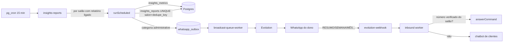

# SysHair Insights — Meu Salão em Números

Relatórios semanais, mensais e anuais, alertas e consultas pelo WhatsApp do dono.

## Fluxo

## Fontes e fórmulas (`insights_metrics`, período `[início, fim)` no calendário do salão)

| Indicador | Fórmula |
|---|---|
| Atendimentos | `appointments.status = 'completed'` |
| Faturamento | soma de `final_price` dos concluídos + `payments` avulsos (`appointment_id` nulo) pagos no período |
| Sem baixa (previsto) | `pending`/`confirmed` do período; mostrado à parte, **nunca somado** |
| Cortes | concluídos com `services.insights_category` em `corte` ou `combo` |
| Outros serviços | atendimentos − cortes |
| Ticket médio | faturamento ÷ atendimentos |
| Clientes únicos | `client_id` (ou telefone) distintos entre concluídos |
| Novos clientes | primeira visita concluída da vida do cliente cai no período |
| Cancelamentos | `status = 'cancelled'`; taxa = cancelados ÷ (concluídos + cancelados + faltas) |
| Dia de pico | dia da semana com mais concluídos |
| Horário de pico | bloco fixo de 1h pelo **horário de início** (não ocupação) |
| Serviço campeão / profissional | maior número de concluídos (profissional só se `show_professional_ranking`) |
| Variação | `(atual − anterior) ÷ anterior`; com anterior zero: "sem base de comparação" |

Períodos: semana = segunda a domingo; mês = calendário; ano = 1/jan a 31/dez. Anterior = mesmo tamanho imediatamente antes.

Categorias de serviço (`services.insights_category`): `corte`, `barba`, `combo`, `quimica`, `estetica`, `outro`. Preenchidas por sugestão de nome na migration; o dono pode corrigir. Serviços `outro` geram dica para classificar.

**Situação atual dos dados:** nenhum agendamento está `completed` em produção (só pendente/confirmado/cancelado) e `payments` está vazio. Os relatórios vão mostrar faturamento R$ 0,00 e orientar a dar baixa na agenda até os salões passarem a concluir atendimentos.

## Envio

- `insights_settings` por salão: liga/desliga semanal, mensal, anual, alertas; dia e horário; limiares e cooldown.
- Vencimento: horário configurado no fuso do salão; janela de 72h (worker atrasado/reiniciado ainda envia; ativar tarde não manda relatório velho).
- Idempotência: `insights_reports UNIQUE(salon_id, dedupe_key)` com chave `tipo:inicio_periodo:destinatario`, inserida **antes** do outbox. Reexecução → `duplicate`. Outbox tem chave própria `insights:<dedupe>`.
- WhatsApp sem instância: relatório registrado como `skipped` (`instance_missing`). Desconectado: o outbox segura e retoma sem gastar tentativa.
- Alertas: semana fechada vs anterior, volume mínimo 5, queda/alta/cancelamento por limiar, dia fraco vs média das 3 ocorrências anteriores do mesmo dia; cooldown por código. Texto declara que não indica causa.
- Recomendações: regras determinísticas (`recommendation`). IA não é usada nos relatórios.

## Segurança

- Destinatário precisa **provar posse** do número: código de 6 dígitos (hash SHA-256 em schema privado, 15 min, 5 tentativas) enviado ao próprio número e respondido no WhatsApp.
- Comandos administrativos só respondem se o remetente for destinatário verificado **do salão da instância** que recebeu a mensagem. Outros números seguem como clientes e nunca veem dados financeiros.
- RLS: dono lê configurações, destinatários e histórico do próprio salão; destinatários e histórico só são gravados pela Edge Function.

## Comandos

`RESUMO` (semana parcial), `SEMANA`, `MÊS`, `ANO`, `AGENDA` (hoje), `PENDENTES`, `MENU`/`AJUDA`.

## Interface

WhatsApp → "Relatórios e Insights pelo WhatsApp": número + verificação, liga/desliga, dia/horário, limiares, visualizar semana passada, gerar mês até agora, enviar teste, histórico.

## Testes

`tests/whatsapp/insights.test.cjs` (períodos, virada de mês/ano, bissexto, fusos, base zero, sem dados, previsto vs recebido, cancelados, alertas, comandos) e `insights-delivery.test.cjs` (worker repetido, desativado, número não verificado, sem instância, isolamento entre salões). Tudo com banco em memória; nenhum envio real.
