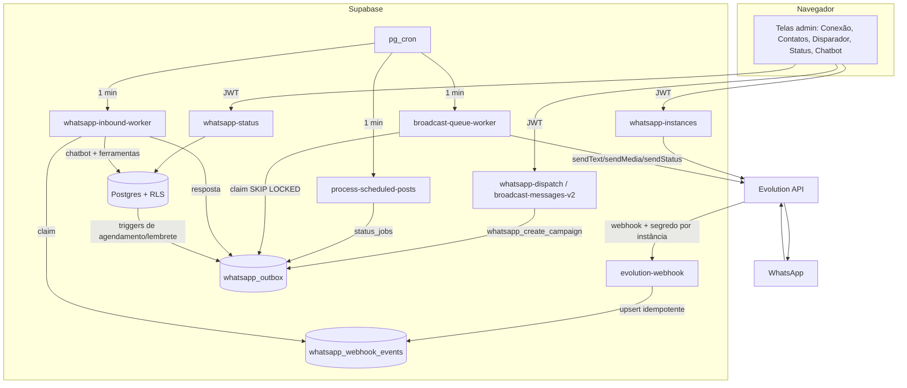

# Automação WhatsApp — SysHair

Estado em 2026-10-11. Branch `feat/whatsapp-automation`. **Ainda não implantado em produção** (exceto as correções de papéis listadas em "Banco").

## Princípios

| Camada | Papel |
|---|---|
| Evolution API 2.3.7 | Ponte com o WhatsApp. Não decide regra de negócio. |
| Supabase (Postgres) | Fonte da verdade: filas, estado, RLS, locks. |
| Edge Functions | Validação, autenticação, chamada à Evolution. |
| pg_cron + `invoke_edge_function` (Vault) | Execução agendada. Frontend nunca agenda com `setTimeout`. |
| IA | Interpreta linguagem; só age por ferramentas determinísticas e limitadas. |

## Arquitetura



Todo envio sai por **um único caminho**: `whatsapp_outbox` → `broadcast-queue-worker` → Evolution. Campanhas, lembretes, confirmações, status e respostas do chatbot compartilham fila, rate control, retry e idempotência.

## Evolution API

Rotas usadas (`supabase/functions/_shared/whatsapp/evolution.ts`), conferidas no código da versão 2.3.7:

| Operação | Rota |
|---|---|
| Criar instância | `POST /instance/create` |
| QR / conectar | `GET /instance/connect/{instance}` |
| Estado | `GET /instance/connectionState/{instance}` |
| Desconectar / excluir | `DELETE /instance/logout|delete/{instance}` |
| Webhook | `POST /webhook/set/{instance}` |
| Contatos | `POST /chat/findContacts/{instance}` |
| Texto | `POST /message/sendText/{instance}` |
| Mídia | `POST /message/sendMedia/{instance}` |
| Status | `POST /message/sendStatus/{instance}` (`allContacts: true`) |

Chave da Evolution fica só em secrets das Edge Functions (`EVOLUTION_API_URL`, `EVOLUTION_API_KEY`). URL precisa ser HTTPS pública (bloqueio SSRF).

## Multi-tenancy e segurança

- Cada salão tem uma instância; `instance_name` único.
- Webhook: segredo por instância em `whatsapp_private.instance_secrets` (schema sem acesso de `anon`/`authenticated`), comparação em tempo constante. Salão é resolvido pela instância, nunca pelo payload.
- Edge Functions de usuário derivam o salão do JWT (`authorizeSalon`); workers exigem service role (`authorizeWorker`).
- Toda tabela nova tem RLS por `salons.owner_id = auth.uid()`; políticas `USING(true)` só para `service_role`.
- RPCs de fila revogadas de `anon`/`authenticated`.
- Mídia em bucket privado `whatsapp-media` (`{salon_id}/...`), enviada por URL assinada de 5 min.

## Conexão

Estados exibidos: sem conexão → QR → conectando → conectado → desconectado (reconectar). Mensagens de erro em linguagem simples, sem stack/token.

## Contatos

Formatos: **`.vcf` (vCard 2.1/3.0/4.0)** e **`.csv`** (separador `,` ou `;`, colunas detectadas por nome: nome/telefone/celular/whatsapp), além da sincronização da Evolution (grupos e `status@broadcast` descartados).

- Normalização central com `libphonenumber-js` (`src/features/whatsapp/contacts/phone.ts`): padrão BR para números sem país; números com `+` mantêm o país.
- Deduplicação por telefone E.164 contra a base e dentro do arquivo.
- Pré-visualização com novos / já cadastrados / inválidos, busca e seleção antes de importar.

`.xlsx` não suportado: exporte a planilha como CSV.

## Disparador (campanhas)

1. Seleção de destinatários (clientes cadastrados, contatos importados/sincronizados), contador e confirmação explícita.
2. `whatsapp_create_campaign` cria `broadcasts` + um item de `whatsapp_outbox` por destinatário com chave de idempotência `campaign:{id}:{telefone}` — reexecução não duplica.
3. Imediato ou agendado (`scheduled_for`, fuso do salão).
4. Worker: claim atômico (`FOR UPDATE SKIP LOCKED`), uma mensagem em voo por instância, intervalo mínimo de 3 s, backoff exponencial (até 15 min), `max_attempts`.
5. Estados por destinatário: `pending → processing → accepted | failed | cancelled | uncertain` (+ `delivered`/`read` só se a Evolution confirmar por webhook).
6. Cancelar: campanha agendada ou em andamento cancela itens não enviados; enviados permanecem.
7. `{{nome}}` substituído pelo primeiro nome; sem nome, a saudação é ajustada (nunca envia `{{nome}}` literal).

**WhatsApp desconectado:** item volta para `pending` sem consumir tentativa e a instância pausa 5 min; a campanha retoma sozinha após reconectar.

**`uncertain`:** a requisição pode ter chegado ao WhatsApp mas não houve confirmação (timeout/5xx após início do envio). Não é reenviado automaticamente para evitar duplicata.

### Opt-out (LGPD)

Cliente que responde PARAR/SAIR é registrado em `whatsapp_marketing_suppression` e `clients.marketing_opt_out`. Campanhas (`category = marketing`) ignoram o contato na criação e de novo no envio. Mensagens transacionais (confirmação, lembrete) não são bloqueadas.

## Status / postagens

- Tipos: texto, imagem (JPG/PNG/WebP até 5 MB), vídeo (MP4 até 16 MB).
- Horário informado no **fuso do salão** (`salons.timezone`), convertido no servidor com Temporal (`disambiguation: reject` evita horários ambíguos/inexistentes).
- Recorrência: não repetir, diária, semanal (dias escolhidos), mensal; com data final opcional. Guardada como regra; a próxima ocorrência é calculada após cada publicação (sem pré-gerar registros).
- Cron `process-scheduled-posts` (1 min) enfileira posts vencidos (`scheduled_at <= now()`), tolerando atraso.

Limitação real: a resposta da Evolution confirma aceite, não visualização. "Publicado" = aceito pelo provedor.

## Automações de agendamento

Configuradas em **WhatsApp → Mensagens automáticas** (tudo desligado por padrão):

| Evento | Gatilho | Envio |
|---|---|---|
| Confirmação | insert / status → confirmed | imediato |
| Lembrete | `whatsapp_enqueue_reminders` | 2 dias…30 min antes (escolhidos pelo dono) |
| Cancelamento | status → cancelled | imediato |
| Remarcação | data/hora alterada | imediato |
| Aniversário | `auto-birthday-messages` diário | |

Cada mensagem guarda `expected_appointment_version` (= `updated_at`). Se o agendamento mudar ou for cancelado antes do envio, o worker cancela a mensagem antiga (`appointment_changed`). Lembretes cujo horário já passou não são enfileirados.

## Chatbot

Fluxo: webhook → `whatsapp_webhook_events` (idempotente por `instance + tipo + message_id`) → `whatsapp-inbound-worker` → `chatbotReply` → resposta no outbox.

- Ignora: `fromMe`, grupos, `status@broadcast`, edições/protocolo. Saídas do próprio sistema nunca entram como inbound → sem loop.
- Bot desligado globalmente: não responde nada (só registra opt-out silenciosamente).
- Pausa por conversa (`whatsapp_conversation_state.human_takeover`): cliente pede atendente/humano ou dono pausa pela aba Histórico; retomar pela mesma aba.
- Fora do horário configurado: mensagem de ausência.
- Contexto: prompt do salão + base de conhecimento (20 itens) + últimas 10 mensagens.
- Ferramentas (`chatbot-domain.ts`), todas presas ao salão do evento autenticado: serviços/preços, profissionais, horários disponíveis (`get_available_time_slots`), meus agendamentos (só do próprio telefone), `prepare_booking`, `prepare_cancel`, `prepare_reschedule`.
- Cancelar/remarcar: só agendamentos ativos do próprio telefone, com ≥ 24h de antecedência (atual e novo horário), novo horário precisa estar livre com o mesmo profissional. Bot propõe → cliente responde **CONFIRMAR** → `whatsapp_change_appointment` faz um único UPDATE (o horário antigo só é liberado se o novo for aceito pelo trigger de conflito).
- Mensagens de número verificado do dono com comandos de relatório vão para o SysHair Insights (ver `docs/INSIGHTS.md`) antes do chatbot.
- Criar agendamento exige `prepare_booking` → cliente responde **CONFIRMAR** → `whatsapp_book_appointment` (idempotente por chave de pedido), e o recurso precisa estar ligado em Mensagens automáticas. Agendamento nasce `pending` para o salão confirmar.
- Privacidade: nunca recebe SQL nem lista de clientes; ferramenta de agenda retorna apenas horários livres.
- Provedores: OpenAI/Groq/Grok com ferramentas; Perplexity/Gemini sem ferramentas de agenda (respondem só com fatos públicos).

## Concorrência da agenda

Trigger `whatsapp_validate_appointment` em `appointments`:
- lock consultivo por salão+dia e verificação de sobreposição para todo insert/alteração de horário ativo → dois clientes não pegam o mesmo horário;
- booking público (`anon`) e bot também precisam bater com a grade oficial e duração do serviço;
- equipe autenticada pode encaixar fora da grade;
- mudança só de status/pagamento/notas não revalida serviço/duração (agendamentos antigos continuam editáveis).

## Workers (pg_cron)

| Job | Frequência | Função |
|---|---|---|
| `process-broadcast-queue` | 1 min | `broadcast-queue-worker` (outbox) |
| `whatsapp-inbound-worker` | 1 min | chatbot |
| `process-scheduled-posts` | 1 min | status agendados |
| `process-pending-notifications` | existente | lembretes |
| `birthday-messages-daily` | diário | aniversário |

Recuperação: lease expirado antes do envio volta para `pending`; depois do envio vira `uncertain`. Eventos inbound travados após 3 tentativas viram `failed`.

## Banco

Migrations (ordem): `20261009000100` … `20261009001300`, `20261011000100`, `20261011000200`.

Já aplicado em produção:
- `20261011000100` (papéis do dono, `get_user_salon_id` determinístico) — aplicado de propósito.
- `20261009000100_whatsapp_security` — **aplicado acidentalmente** durante um dry-run (o arquivo tinha `BEGIN/COMMIT` próprio). Efeitos: RLS de templates restrita ao dono, RPCs de fila só para service role, segredos de webhook gerados, `instance_token` movido para schema privado, trigger de admin do dono. O `GRANT` de escrita em `whatsapp_instances` foi restaurado manualmente porque o frontend em produção ainda grava status/QR direto na tabela; a revogação volta a valer quando esta branch for implantada (migration reaplicada).

Dry-run completo das 15 migrations contra a produção, em transação revertida: todas OK.

## Testes

```
node tests/whatsapp/security.test.cjs       # 6
node tests/whatsapp/contacts.test.cjs       # 4
node tests/whatsapp/chatbot-tools.test.cjs  # 5
node tests/whatsapp/schedule.test.cjs       # 5
```
Todos offline com transporte mockado; nenhum teste envia mensagem real.

## Implantação (ordem)

1. Rotacionar a chave da Evolution exposta em arquivos antigos do repositório e configurar secrets `EVOLUTION_API_URL`, `EVOLUTION_API_KEY`.
2. Aplicar migrations.
3. Deploy das Edge Functions alteradas/novas.
4. Webhook autenticado é registrado na Evolution automaticamente no próximo "conectar" ou na primeira consulta de status com a instância conectada (`whatsapp_webhook_synced`). Até isso ocorrer, o webhook novo rejeita eventos dessa instância — abrir a tela WhatsApp de cada salão logo após o deploy (ou chamar a ação `sync_webhook`).
5. Deploy do frontend.
6. Teste real com número de teste: conectar, mensagem para si, campanha de 1 contato, status, chatbot.

## Troubleshooting

| Sintoma | Onde olhar |
|---|---|
| "Por que a mensagem da Maria não foi?" | `whatsapp_outbox` filtrando `recipient_phone`: `status`, `error_code`, `attempts` |
| Campanha parada | `error_code = 'disconnected'` → reconectar |
| Chatbot mudo | `chatbot_settings.enabled`, `whatsapp_conversation_state.human_takeover`, `whatsapp_webhook_events.status` |
| Webhook rejeitado (401) | segredo divergente → ação `sync_webhook` em `whatsapp-instances` ou "Reconectar" |
| Lembrete não saiu | `whatsapp_automation_settings.reminders_enabled`; `error_code = 'appointment_changed'` é esperado após alteração |
